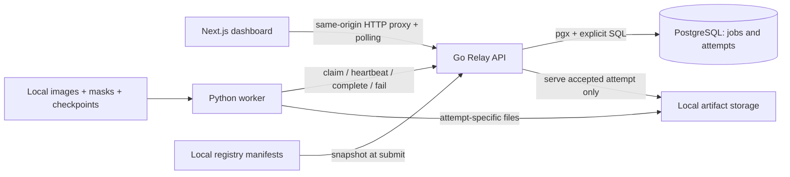
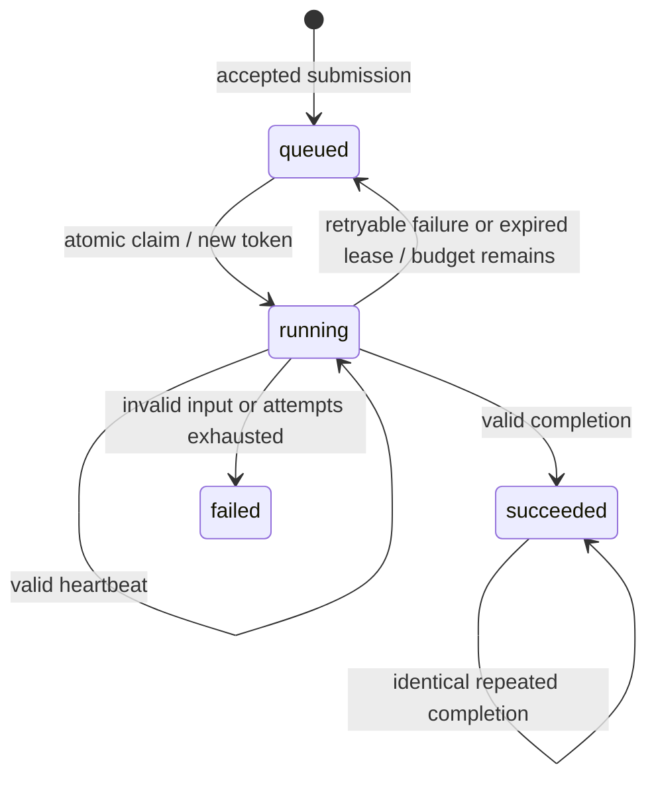

# Architecture and queue reliability

The queue core in `relay/store.go` knows JSON jobs, attempts, leases and result digests. It does not import ML code or know about pixels. The HTTP layer validates the two registered task types. Python never connects to PostgreSQL. Next never connects to PostgreSQL. Both use Relay.

## Job states

Attempts have their own states: running, succeeded, failed, expired. A job may have several attempts, but only one current token. `max_attempts` counts the first execution too; default 3, maximum 8. Retries wait `min(60, 2^attempt_number)` seconds: 2, 4, 8… seconds. The lease defaults to 12 seconds, worker heartbeat interval to 1 second, and recovery scanning to 1 second. Backoff also applies to crashed workers. There is no jitter or priority scheduling in this MVP.

## Why a lease and a token are different

A lease is a deadline after which Relay may hand the job to someone else. The token identifies **which execution** owns the current lease. Checking only the job ID is unsafe: a worker may pause, lose its lease, then wake up after another worker has finished. Every heartbeat, failure and completion locks the job and checks its current state, token and unexpired deadline using PostgreSQL `statement_timestamp()`.

A worker's local clock never determines ownership. A late heartbeat cannot revive an expired lease, even if the reaper has not yet run. A worker unable to reach Relay may continue computing temporarily; its eventual completion is still fenced by the server. The worker stops at its next progress callback when it learns it lost ownership.

## Transaction boundaries

1. **Submission:** INSERT with a unique idempotency key and `ON CONFLICT DO NOTHING`. A separate SELECT under READ COMMITTED sees the winning row, including a concurrently committed insert. Compare normalized request JSON using PostgreSQL JSONB equality. Same key and payload returns the original job; different payload returns 409. Defaults are normalized. The original registry snapshot is retained, even if files later change.
2. **Claim:** begin; select one ready queued row with `FOR UPDATE SKIP LOCKED`; assign a random 128-bit token, increment attempt count, set lease using database time, insert attempt; commit. Locked jobs are skipped so another worker need not wait for that row. No inference happens inside this transaction.
3. **Heartbeat/completion/failure:** lock the row; issue a fresh statement checking database time after the lock is acquired; perform both job and attempt updates; commit. Network delivery of the response happens after commit.
4. **Recovery:** lock up to 100 expired jobs with `SKIP LOCKED`; mark their attempts expired; requeue with backoff or mark terminal failure; commit. Recovery runs periodically and before claims.

READ COMMITTED plus explicit row locks is sufficient here: ownership checks and writes serialize on the same job row. The application has no cross-job invariant requiring serializable transactions. Short transactions reduce lock contention. Scheduling is approximately FIFO among available jobs, not a strict fairness guarantee.

## Constraints and indexes

- Unique `idempotency_key` serializes duplicate submissions.
- Primary keys on job ID and token; unique `(job_id, number)` prevents duplicate generations.
- Attempts reference jobs with a foreign key.
- CHECK constraints restrict states, attempt bounds and progress, require a lease exactly when running, and require an accepted digest exactly when succeeded.
- Partial index `(available_at, created_at)` over queued jobs supports claims.
- Partial index on running leases supports expiry scans.
- The attempt unique index supports ordered history lookup by job ID.

Schema initialization is idempotent for this initial version, not a migration framework. Before evolving a used schema, write an explicit versioned migration; `CREATE TABLE IF NOT EXISTS` cannot upgrade old columns.

## Filesystem versus database

Each claim writes under `storage/artifacts/<job_id>/<token>/`. Files from another attempt are never reused. Images are closed and fsynced; `result.json` is written to a temporary file, fsynced, renamed atomically, then its containing directory is fsynced. Workers send its SHA-256, not an arbitrary path. Relay reads that deterministic file, checks valid JSON and the digest, and only then attempts the guarded database commit.

There is no atomic transaction spanning PostgreSQL and the filesystem:

| Crash point | Consequence |
| --- | --- |
| Before claim commit | No claim is visible; another worker can claim normally. |
| After claim commit, before response | Attempt remains running until its lease expires. |
| During computation or file writes | Lease recovery schedules a new attempt; partial files may remain. |
| After file rename, before completion commit | Complete-looking orphan files remain, but are not accepted results. |
| After completion commit, before HTTP response | Job already succeeded; identical token + digest completion returns the same success. |
| API restart | State remains in PostgreSQL; expired leases are reaped on restart. |
| Disk loss after successful commit | Reference exists but artifact is unavailable; storage backups are outside this MVP. |

Only accepted attempts are served by the API. Old attempt directories can remain as diagnostic evidence; automatic retention/garbage collection is not implemented. Never remove an accepted directory while keeping its database reference. Process-crash recovery is tested; power-loss filesystem and database recovery are not tested here.

**At-least-once execution:** work may run twice. Fencing protects the single accepted result reference; it does not prevent duplicate computation or provide exactly-once execution.

## Local trust boundary

Go binds to 127.0.0.1; Next and Compose port mappings also bind locally. The API accepts registered tasks/configurations, not shell commands. Registry IDs and artifact basenames are validated. Go `os.Root` prevents traversal and symlink escape from the artifact root. Python resolves dataset/checkpoint paths beneath `STORAGE_ROOT` and verifies hashes. Host headers and browser origins are restricted to localhost to reject cross-origin requests and DNS rebinding; the dashboard proxies through the same origin.

Workers and local registry maintainers are trusted. A malicious same-user process can alter files or call unauthenticated worker endpoints; lease tokens are correctness fences, not a multi-tenant authorization system. Do not expose this setup publicly. Result digests detect a modified accepted JSON file. Multi-host shared storage, authentication and hostile-worker isolation are not implemented.
